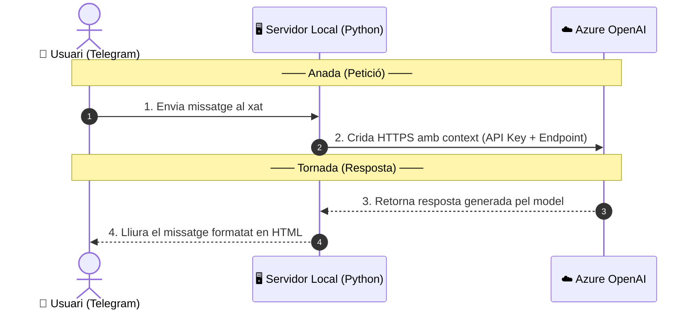

# 🤖 Bot de Telegram amb Azure OpenAI

> Guia pas a pas per aprovisionar el servei Azure OpenAI, desplegar un model en pagament per ús (*Data Zone Standard*), crear el bot a Telegram amb BotFather i connectar-ho tot mitjançant un servidor local en Python.

---

## 🔄 Flux Bidireccional



| Pas | Sentit | Origen | Destí | Descripció |
| :-: | :---: | :--- | :--- | :--- |
| **1** | ➡️ Anada | Usuari | Servidor Python | L'usuari envia una consulta des de Telegram. |
| **2** | ➡️ Anada | Servidor Python | Azure OpenAI | El codi envia l'historial i la consulta a la IA via HTTPS segur. |
| **3** | ⬅️ Tornada | Azure OpenAI | Servidor Python | El model processa la petició i retorna el text generat. |
| **4** | ⬅️ Tornada | Servidor Python | Usuari | El bot mostra la resposta formatada directament al xat de Telegram. |

---

## ☁️ 1. Crear el recurs Azure OpenAI (Portal Azure)

> [!IMPORTANT]
> Crea el servei **Azure OpenAI**, **no** un recurs d'Azure AI Foundry genèric.

1. Entra a [portal.azure.com](https://portal.azure.com) amb el teu compte de Microsoft.
2. Cerca **Azure OpenAI** a la barra superior i fes clic a **+ Create**.
3. Emplena els camps requerits:
   - **Subscription**: La teva subscripció activa.
   - **Resource group**: Tria'n un o crea'n un de nou (ex: `rg-telegram-bot`).
   - **Region**: Tria una regió amb quota disponible (ex: `Sweden Central`, `East US 2`).
   - **Name**: Nom únic per al recurs (ex: `openai-telegram-servei`).
   - **Pricing tier**: Selecciona `Standard S0`.
4. Fes clic a **Review + create** i després a **Create**.

---

## 🧠 2. Desplegar el model a Azure AI Foundry (`oai.azure.com`)

1. Entra a [oai.azure.com](https://oai.azure.com) o prem **Go to Azure AI Foundry portal** des del teu recurs al portal d'Azure.
2. Al menú lateral esquerre, accedeix a **Model catalog** (*Catàleg de models*).
3. Cerca el model que vulguis, per exemple: `gpt-5.4-mini`.
4. Fes clic a **Use this model** (*Utilitzar aquest model*) > **Deploy**:
   - **Deployment name**: Nom del desplegament (ex: `gpt-5.4-mini-2`).
   - **Deployment type**: Selecciona **Data zone standard** (*Estàndard de zona de dades*).
     > [!TIP]
     > Aquesta opció funciona per **pagament per ús** (*Pay-as-you-go*): només pagues pels tokens consumits en cada consulta, sense quotes mensuals fixes.
5. Fes clic a **Deploy**. Quan finalitzi, copia les dades de connexió:
   - **Endpoint**: `https://<nom-del-recurs>.openai.azure.com/`
   - **API Key**: Clau d'accés privada (Key 1 o Key 2)
   - **API Version**: `2024-12-01-preview`
   - **Deployment Name**: `gpt-5.4-mini-2`

---

## 📱 3. Crear el bot a Telegram (@BotFather)

1. Obre l'aplicació de Telegram i cerca **`@BotFather`** (amb xec blau oficial).
2. Envia `/start` per obrir el menú.
3. Envia la comanda `/newbot`.
4. Introdueix un nom visible per al bot (ex: `Consultor Agrícola IA`).
5. Introdueix un nom d'usuari únic acabat en `bot` (ex: `consultor_agricola_ia_bot`).
6. BotFather et retornarà el teu **Token d'API**:
   ```text
   1234567890:ABCdefGHIjklMNOpqrSTUvwxyz123456789
   ```

---

## 🐍 4. Instal·lació de dependències

Al teu terminal, instal·la les dues llibreries necessàries:

```bash
pip install pyTelegramBotAPI openai
```

---

## 💻 5. Codi Python (`bot.py`)

Crea el fitxer `bot.py` amb el codi següent, indicant les teves claus i endpoints:

```python
from openai import AzureOpenAI
import telebot

# Configuració de claus i endpoints
AZURE_OPENAI_ENDPOINT = "https://<nom-del-teu-recurs>.openai.azure.com/"
AZURE_OPENAI_API_KEY = "la_teva_clau_api_d_azure"
DEPLOYMENT_NAME = "gpt-5.4-mini-2"
TELEGRAM_TOKEN = "el_teu_token_de_botfather"

# Inicialització de clients
bot = telebot.TeleBot(TELEGRAM_TOKEN)
client = AzureOpenAI(
    azure_endpoint=AZURE_OPENAI_ENDPOINT,
    api_key=AZURE_OPENAI_API_KEY,
    api_version="2024-12-01-preview"
)

# Memòria de conversa per mantenir el context
user_context = {}

SYSTEM_PROMPT = """Ets un consultor agrícola amb molts coneixements. Respon de manera professional i detallada.
IMPORTANT FORMAT: Utilitza exclusivament format HTML de Telegram. 
- Utilitza <b>negreta</b> per ressaltar termes clau.
- Utilitza <i>cursiva</i> per a noms científics.
- Utilitza llistes amb guions o números.
- No utilitzis Markdown (ni asteriscs ** ni coixinets ##)."""

@bot.message_handler(commands=['start', 'help'])
def send_welcome(message):
    chat_id = message.chat.id
    welcome_text = "👋 <b>Hola!</b> Sóc el teu consultor agrícola virtual.\n\nEscriu la teva consulta i et respondré amb informació detallada."
    bot.send_message(chat_id, welcome_text, parse_mode="HTML")
    
    user_context[chat_id] = [{"role": "system", "content": SYSTEM_PROMPT}]

@bot.message_handler(func=lambda message: True)
def handle_message(message):
    chat_id = message.chat.id
    user_text = message.text

    if chat_id not in user_context:
        user_context[chat_id] = [{"role": "system", "content": SYSTEM_PROMPT}]

    user_context[chat_id].append({"role": "user", "content": user_text})
    
    bot.send_chat_action(chat_id, 'typing')

    try:
        response = client.chat.completions.create(
            model=DEPLOYMENT_NAME,
            messages=user_context[chat_id],
            temperature=0.7,
            max_completion_tokens=1000
        )
        
        bot_reply = response.choices[0].message.content
        user_context[chat_id].append({"role": "assistant", "content": bot_reply})
        
        try:
            bot.reply_to(message, bot_reply, parse_mode="HTML")
        except telebot.apihelper.ApiTelegramException:
            bot.reply_to(message, bot_reply)

    except Exception as e:
        bot.reply_to(message, "⚠️ <i>S'ha produït un error de connexió amb el servidor.</i>", parse_mode="HTML")
        print(f"Error de connexió: {e}")

if __name__ == "__main__":
    print("🤖 El bot de Telegram està en funcionament. Prem Ctrl+C per aturar-lo.")
    bot.infinity_polling()
```

---

## 🚀 6. Execució i Prova

1. Inicia el servidor des del teu terminal:
   ```bash
   python3 bot.py
   ```
2. Obre **Telegram**, cerca el teu bot i prem **/start**.
3. Envia qualsevol consulta (ex: *"Quina és la millor època per sembrar blat de moro?"*).
4. El servidor local gestionarà la petició amb Azure OpenAI i et retornarà la resposta formatada al xat.

---

## 🛠️ Resolució de Problemes Freqüents

| Error | Causa | Solució |
| :--- | :--- | :--- |
| `Unauthorized (401)` a Telegram | Token de Telegram incorrecte | Revisa el token proporcionat per `@BotFather`. |
| `NotFoundError (404)` a Azure | Nom de desplegament no coincident | Comprova que `DEPLOYMENT_NAME` coincideixi amb el nom del desplegament a Foundry. |
| `AuthenticationError (401)` a Azure | Clau d'API d'Azure invàlida | Torna a copiar la clau des de *Keys and Endpoint* al portal d'Azure. |
| `RateLimitError (429)` | Quota de tokens per minut superada | Augmenta el límit de TPM a la configuració del model a Azure AI Foundry. |
